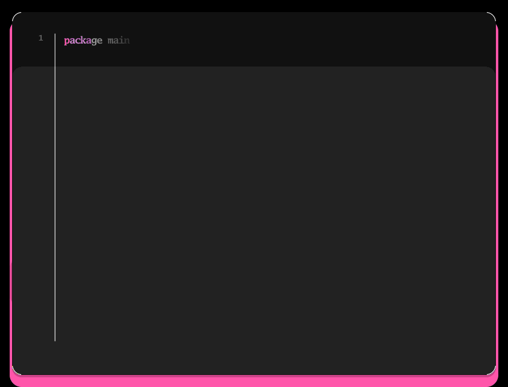
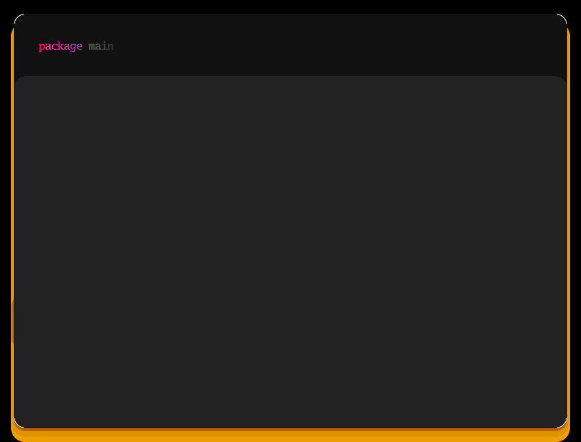
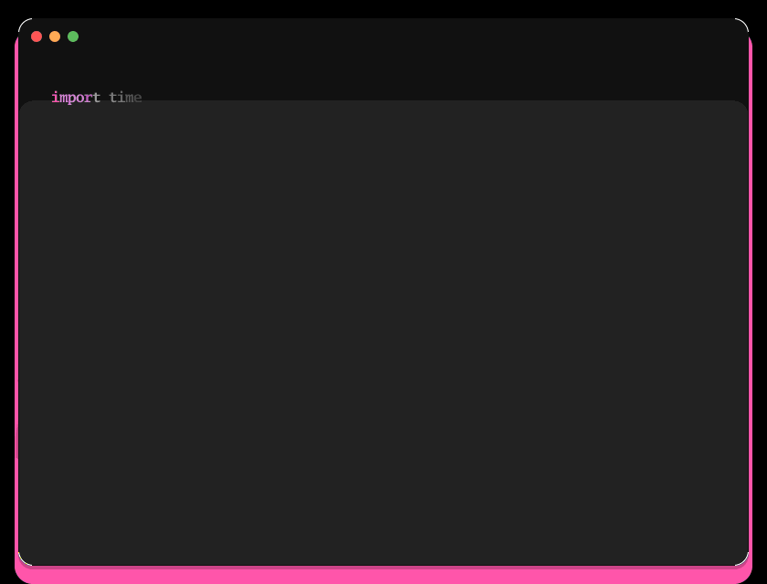
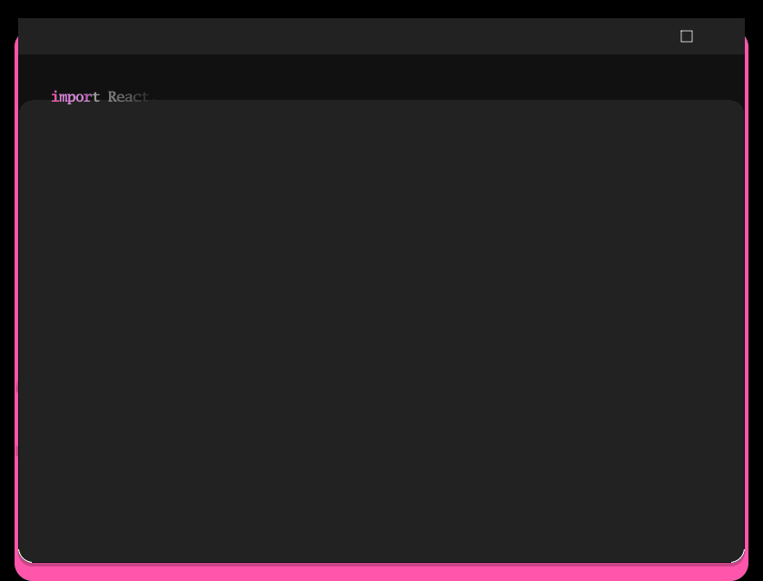

# gif-my-code

A command-line tool that turns a source file into an animated GIF (or MP4) with syntax highlighting, line highlighting and optional window chrome.

It is for developers who want animated code snippets for READMEs, tutorials, documentation, talks and social posts, without a browser or an account.



## Features

- Syntax highlighting for 250+ languages through [chroma](https://github.com/alecthomas/chroma), with auto-detection from the file extension or `--lang`.
- 70+ color themes. Run `gif-my-code --list-themes` for the full list.
- Two animations: a laser reveal (the default) and a typing animation (`--laser=false`).
- Line highlighting with ranges, for example `--highlight "5,7-9"`.
- macOS and Windows window chrome, line numbers, gradient background, drop shadow, adjustable speed, size, font size, padding and FPS.
- HiDPI output at 2x (`--hidpi`).
- GIF or MP4 output. MP4 needs `ffmpeg`.
- Reads code from stdin as well as from a file.

| Themes | Line highlighting |
| --- | --- |
|  |  |
|  |  |

## Installation

Requires Go 1.26 or newer (`go.mod`). `ffmpeg` is optional and only needed for MP4 output.

```bash
go install github.com/forbiddenlink/gif-my-code@latest
```

Or build from source:

```bash
git clone https://github.com/forbiddenlink/gif-my-code.git
cd gif-my-code
go build -o gif-my-code
```

## Usage

```bash
gif-my-code example.go                         # writes code.gif
gif-my-code example.py -o demo.gif             # choose the output path
gif-my-code example.js --theme monokai         # pick a theme
gif-my-code --list-themes                      # list every theme
gif-my-code example.js --laser=false           # typing animation
gif-my-code example.tsx --speed 2.0            # faster
gif-my-code example.go -o demo.mp4             # MP4 (format follows the extension)
cat example.go | gif-my-code --lang go -o demo.gif   # stdin
```

A tutorial-style example:

```bash
gif-my-code component.tsx \
  --window macos \
  --highlight "3,5-7" \
  --line-numbers \
  --theme dracula \
  --width 1000 \
  -o tutorial.gif
```

### Options

```text
gif-my-code [file] [flags]

  -t, --theme string       Color theme (default "dracula")
  -s, --speed float        Typing speed multiplier (default 1.0)
  -o, --output string      Output file path (default "code.gif")
      --format string      Output format: gif or mp4 (auto-detected from the extension if omitted)
  -w, --width int          Image width in pixels (default 800)
  -f, --font-size float    Font size (default 16)
  -l, --lang string        Force language (auto-detect if not provided)
      --highlight string   Lines to highlight, e.g. '5,7-9'
      --line-numbers       Show line numbers
      --window string      Window style: macos, windows, or none (default "none")
      --laser              Laser reveal animation instead of typing (default true)
      --no-cursor          Disable the cursor animation
      --hidpi              Render at 2x resolution
      --padding int        Inner padding in pixels at 1x scale
      --fps int            Frames per second (default 30)
      --list-themes        Print the available themes and exit
```

Run `gif-my-code --help` for the current defaults.

## Development

```text
cmd/                CLI entry (Cobra)
internal/parser/    file and stdin reading, language detection
internal/highlight/ syntax highlighting (chroma)
internal/render/    frame rendering
internal/animator/  frame generation
internal/encoder/   GIF and MP4 encoding
examples/           sample code files
demos/              showcase GIFs
assets/             icon and social preview
```

```bash
go build -o gif-my-code
go test ./...
```

## Roadmap

Not built yet: custom fonts, custom highlight colors, a watermark option, a diff mode, annotations, and batch processing. Ideas and requests go in [Issues](https://github.com/forbiddenlink/gif-my-code/issues).

## Contributing

Fork the repo, create a branch, make your change with a test where it makes sense, and open a pull request. Conventional commit messages are used (`feat:`, `fix:`, `docs:`).

## License

MIT. See [LICENSE](LICENSE).
